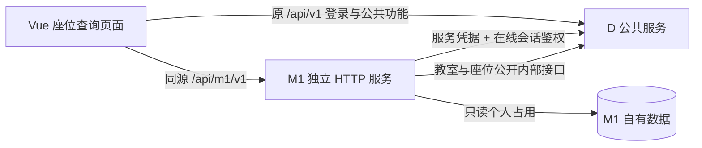

# M1 只读 HTTP 查询与 D 真实网络接入方案

日期：2026-10-28。状态：用户 leafwhisper286 已回复“同意”，确认本步只读范围；开始实施，结果另记验证记录。本方案对应CF-M1-001/012的下一阶段，沿用已完成的权限/范围/插座规则，不重新选择事务锁或要求提前联系B。

## 1. 本步交付与边界

推荐先完成：已有D登录 → 进入“座位查询”页面 → 选择有权限的教室、整点时段及插座筛选 → M1经真实HTTP向D认证并读取主数据 → 查询M1个人占用 → 展示候选座位。

页面不开放提交预约，文案明确“当前仅支持查询，预约暂未开放”。候选结果尚不含M2占用和M3维修判断，不能作为完整可预约承诺或给M2审批使用。本步不改D公开契约、不增加数据库迁移、不做预约/签到/通知写入。

创建预约、历史复用、M2/M3和完整可用性等需求继续保留，不能因为分阶段只读而删除验收要求。

## 2. 接入方式选择

| 方式 | 影响 |
| --- | --- |
| 同一Vue入口按路径代理到独立D/M1服务（推荐） | 延续现有同源Cookie登录，浏览器只访问一个入口；M1独立运行并通过D公开接口取数据 |
| 浏览器分别直连D和M1端口 | 需要额外处理跨域和凭据配置；当前没有必要引入这部分复杂度 |

推荐链路：



Vue代理中/api/m1规则优先于现有/api规则；保留D的/api/v1路径，不让M1请求落到D。M1客户端函数单独处理只读请求及错误，不把D的写入CSRF头或服务密钥拼进查询。

## 3. 拟议 M1 浏览器接口

### GET /api/m1/v1/rooms

使用CF_SESSION在线检查seats.availability.read；M1用服务凭据从D读取ROOM，按本人院系/bookingScope及基础有效性筛选。客户端page从0开始、size为1～100。返回`{items,page,size,total}`，items包括教室id/code/name/bookingScope和展示所需的开放时段。

不要求用户另有spaces.read才能使用M1查询；M1不把D的完整服务目录直接转发给浏览器。需要取得D多页数据后再做范围过滤和对外分页，不能把D的未过滤total当作本人可用教室数。

### GET /api/m1/v1/seat-candidates

参数：roomId、startAt、endAt、requiresPower（缺省false）、page（缺省0）、size（缺省20，上限100）。id为UUID；起止为UTC ISO-8601 Z；按上海时区整点校验。未知参数、重复的单值参数、非法布尔值/分页/时段拒绝，不接受userId、departmentId或permission作为授权依据。

拟议响应示意（虚构数据）：

```json
{
  "roomId": "00000000-0000-0000-0000-000000000101",
  "startAt": "2026-10-29T01:00:00Z",
  "endAt": "2026-10-29T03:00:00Z",
  "reason": "NONE",
  "items": [{"id": "00000000-0000-0000-0000-000000000102", "code": "A101-S1", "hasPowerOutlet": true}],
  "page": 0,
  "size": 20,
  "total": 1,
  "stage": "CANDIDATE_ONLY",
  "canReserve": false
}
```

reason沿用NONE、ROOM_INACTIVE、OUTSIDE_OPENING_HOURS、USER_TIME_CONFLICT；NONE也可以是正常空列表。total在范围、开放、插座和个人占用全部筛选后计算。结果不含他人身份或预约详情，不是多服务同一时刻快照；canReserve=false表示本阶段没有预约写入口，不表示座位已经被占用。

## 4. 身份与主数据读取

1. 浏览器仅携带现有HttpOnly CF_SESSION；M1服务端提取并调用D的POST /internal/v1/authorization，请求权限固定为seats.availability.read。用户身份不从前端载荷取得。
2. allowed=false且没有有效identity表示未登录/失效，返回401；有效身份但缺业务权限返回403。allowed=true仍须有完整有效身份及相应权限字段，否则视作D响应异常，不放行。
3. M1使用D返回身份与ROOM.bookingScope执行个人预约范围判断；DEPARTMENT须本人院系匹配，CAMPUS也必须有业务权限，不能继承D的ADMIN管理范围例外。
4. 读取指定ROOM及SEAT全部页，核查资源类型、id、父教室、院系、effectiveActive、范围枚举、开放规则及属性。D未来新增非关键响应字段可兼容；必需字段缺失或未知范围不能默认放行。
5. 映射到现有M1快照并调用queryForIdentity。D只通过HTTP读取，M1只访问m1自有预约表，不共享D实体或访问D业务表。

M1不新建本地用户或密码登录，也不启用框架默认账号/Basic认证；认证来源只有D。服务启动/故障日志不能输出框架生成密码或任何实际凭据。

D列表跨页不保证快照，需检测重复ID、非预期空页和不完整响应。设置总调用预算和分页上限；超限或中途失败必须报告查询不可用，不返回貌似完整的total。D的seat.version不能作为父级启停缓存信号；不缓存授权或有效性来放行后续请求。

## 5. 错误与运行参数建议

| 情况 | M1对外行为 |
| --- | --- |
| 参数错误、非整点、过去、窗口/时长超限 | 400，明确输入原因 |
| 会话缺失或D确认失效 | 401，页面引导重新登录 |
| 有效会话无业务权限或越预约范围 | 403，不返回教室/座位详情 |
| 指定资源不存在或不是ROOM | 404 |
| 合法查询但没有候选座位 | 200及空items，和服务故障区分 |
| D超时、服务凭据错误、必需字段异常、分页不完整、M1存储失败 | 503，说明暂不可查询，不当作“没有空位” |
| 程序自身未预期异常 | 500，返回requestId，不暴露内部堆栈 |

特别区分：D对M1服务凭据返回401/403，是服务连接/配置故障，不能让浏览器误以为本人退出登录；只有D授权响应中的会话失效才映射浏览器401。

连接超时建议1秒、单次读取2秒、一次业务调用总预算3秒，均配置化，初版不自动重试；分页上限建议100页、每页最多100。预算在多次调用间共享，不能每翻一页重新无限计时。响应Cache-Control:no-store，使用现有格式的requestId，不记录Cookie、密码、Bearer或授权请求体；D地址只能从受控服务配置取得，不从查询参数指定，不跟随跨地址重定向。

预约窗口/时长继续参数化。本步不把“一天＝滚动24小时”设为已经确认的正式默认；联调用例显式注入PT24H/PT4H作为测试参数，正式默认及管理员配置归属仍单列。此次方案确认只覆盖只读接入，不顺带批准预约写入竞态、午夜表示或通知渠道。

## 6. 页面与隔离联调

新增/seat-query路由和“座位查询”导航，按seats.availability.read显示并由M1后端再次鉴权。页面提供教室选择、明确为上海时间的整点起止、插座勾选、分页、加载/空态/错误；不出现可提交的预约操作。没有D目录权限但有M1查询权限的账号仍能直接使用该页面，登录落点按可访问页面处理。

本步只有GET读取；D登录/退出等仍走原CSRF流程，不更改D安全策略。未来M1写入口开放前另行确定并验证其CSRF方案，不把只读接通称为写入保护已完成。

当前运行中的snapshot、5173/8080服务和数据保留。拟使用正式仓库的独立本地环境，例如D 18080、M1 18081、前端5174；端口可配置，冲突时报错而不停止他人进程。使用独立临时PG，D数据和m1数据各自归属、各自迁移，不复用正在运行的演示数据库。

测试环境可以显式创建MEMBER＋SEAT_USER的虚构用户、跨院系教室和标准插座座位作为夹具；这不改变生产迁移“不自动授权已有账号”的规则。演示密码由用户在终端临时设置，服务密钥在本地/测试环境安全注入，不需要用户在聊天中提供或自行编写接口。

## 7. 验收计划（实际执行结果另记）

- 保留并运行现有D24、M1 86、前端11测试，新增数量仅在实际执行后登记。
- 使用真实TCP启动独立D和M1及真实PG，通过D的登录和主数据API准备/读取夹具；验证M1实际发出鉴权/资源HTTP请求，不用MockMvc或假D替代这条集成证据。
- 经D创建有效会话后，M1正常查询；退出/停用/撤销SEAT_USER后，同一会话后续查询被拒绝；仅有spaces.write不能查询。
- DEPARTMENT拒绝外院系，CAMPUS允许有权外院系；插座/启停/开放/个人占用和跨页过滤均正确，测试至少覆盖超过100条资源的D分页。
- 模拟超时、错误服务凭据、分页失败、异常字段时返回503；未登录401、无权403与正常空200有明确区别。
- 查询前后M1三表内容不变，尝试预约写请求不能成功；页面无预约提交入口，候选结果不被标成完整可预约承诺。
- Vue组件测试负责交互；另外在隔离环境通过真实前端代理验证浏览器登录/查询及Network请求。自动测试结果、AI浏览器验证、用户人工验收分别记录，不互相冒充。
- 关键身份/范围/故障处理用隔离破坏实验检验；真实网络测试纳入CI门禁，远程执行情况另记。本步不等于全组部署、M2/M3联调或云端交付。

## 8. 本步分工与开始条件

用户现在学习：页面请求M1，M1既向D核验身份/读取主数据，也向自己的数据库读取个人占用；前端隐藏菜单不能代替后端校验。用户评估是否先按本稿做只读链路；无需重复确认已经授权的D三项，也无需提前转发B说明书。

用户确认本步后，AI负责HTTP适配/服务装配、页面、真实网络测试、独立启动/复验脚本及说明书更新；用户随后运行复验、实际操作页面，再按实际结果提交。其他负责人说明仍由用户后续转交，不代发消息。

当前先形成方案的依据是工作区“用户理解并评估方案后实现”和 [仓库规则](../../AGENTS.md)“先明确任务范围、依赖、验收标准和方案，再实现”。用户已确认本稿；实施不代表其他模块负责人已评审，人工验收后再提交。
