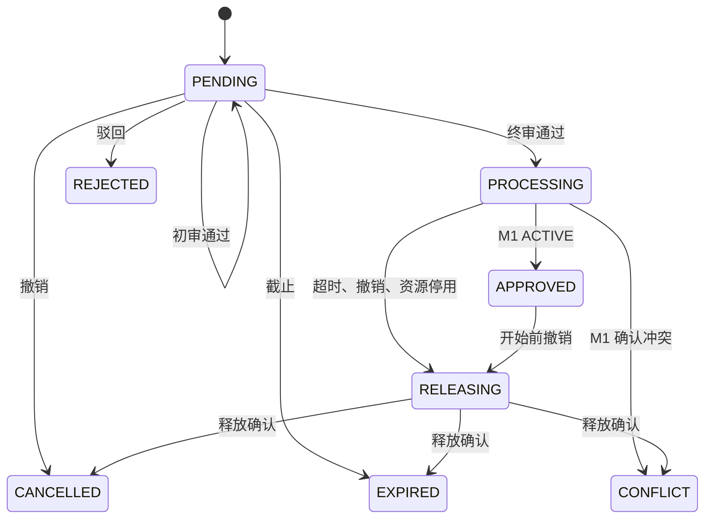

# M2 整教室申请与审批

状态：本地实现版，用户已于 2026-11-02 验收，跨模块评审仍待完成；用户已授权由 AI 决定 M2 业务规则；规则据此采用下文方案，跨模块契约仍不能视为全组已冻结。
授权来源：2026-11-02 用户要求「完成M2模块」，并回复「你自己决定规则」。范围包含 M2 后端、申请/审批页面、D 权限接入、M1 调用端、恢复任务与通知审计。不包含 M1/M3 业务实现、云资源采购或附加 Agent。

## 任务书要求与本次细化

任务书明确要求权限门槛、申请提交、多级审批（通过/驳回）、超时自动撤销，以及审批通过后经 M1 占用整教室所有座位。下面的具体规则是本次实现采用的细化方案，不是任务书原文，也尚无组内一致记录。

| 规则 | 实现 |
| --- | --- |
| 资格 | `rooms.read` 只能查看本人记录；另需 `rooms.apply` 才能提交。MEMBER 没有申请/审批权限。D 管理员明确分配 ROOM_APPLICANT 或自定义权限。 |
| 院系 | 非 ADMIN 只能申请本院系教室，审核/管理也仅本院系。ADMIN 全局，但仍不能自审或连续审批两个节点。 |
| 顺序 | 院系初审 `rooms.review` → 教室终审 `rooms.approve`；固定两级，流程快照存入申请。两个不同审批人，且都不能是申请人。 |
| 时间 | 北京时间，同一天，30 分钟整数时段，至少提前 15 分钟，默认最多提前 30 天、单次 8 小时；须完整处于 D 开放时段内，人数不超过容量。 |
| 截止 | 创建时记录 `min(提交时间+48小时,开始时间)`；以后修改参数不改历史申请截止时间。审批开始时再次判断截止时间。 |
| 重复 | requestKey 在申请人范围内幂等；相同 key 不同内容 409。同人同教室重叠的未结束申请被拒绝。不同申请人的冲突最终由 M1 原子判断。 |
| 待审 | 不占教室，不预留座位。驳回/待审超时不需释放从未申请过的占用。 |
| 批准 | 最终节点通过仅进入 PROCESSING。收到匹配 applicationId、roomId、时间、操作版本的 M1 ACTIVE 回执才变为 APPROVED。 |
| 撤销 | 本人或本院系 rooms.manage 可撤销待审、处理中或尚未开始的已批准申请。已开始的已批准申请不可自行撤销。改时间/教室采用撤销后重新提交。 |
| 释放 | PROCESSING/APPROVED 撤销先进入 RELEASING，操作版本加一；确认 M1 RELEASED 后才变成 CANCELLED/EXPIRED/CONFLICT。 |
| 失败恢复 | 占用/释放自动退避重试，五次起标记需关注但不放弃；管理页可请求重试。不能强制标记批准/释放，也不允许编辑数据库绕过。 |
| 通知审计 | 每次状态变化的历史和待发送事件与业务同事务提交；只通知申请人，审批人从待办读取。D 不可用不丢事件；八次失败标为 DEAD，可人工恢复。SENT 表示 D 已接收，并不等于用户已读。 |

配置见 `services/rooms/src/main/resources/application.yml`；审批节点不是在线工作流设计器，改变节点应新增规则版本并保留旧快照。M1 的四小时规则不自动适用于 M2。

## 状态

状态版本与行锁控制审批、取消、超时并发；M1 单独维护递增 operationVersion。即使版本 1 的占用请求尚未到达，也以版本 2 的释放写入 tombstone，阻止旧请求随后复活。跨服务成功但本地事务失败时，使用相同版本查询/重试。

## 边界及未完成项

- D 拥有身份、院系和教室目录；M2 不读 D 表。M2 独立数据库/迁移/事件记录。
- M1 拥有所有真实资源冲突判断；[M1 占用契约](../../contracts/m2-occupancy-api.md)尚待 M1 负责人评审与实现。M2 测试中的 M1 服务仅为协议故障测试夹具，不算真实集成验收。
- 2026-11-02 已检查远程 M1 分支：个人预约使用房间级 advisory lock，但尚未暴露 room-occupancies。未合并/修改他人的分支。
- 维修后的占用有效性由 M1/M3 协调。M2 保存审批事实；APPROVED 不保证后来没有维修。实时可用性及受影响申请通知仍需全组约定。
- 规则决定已获用户授权，成品已获用户验收、接口仍需组内评审；统计导出不是本次必做范围，没有把 M1 的运营需求自动扩展为 M2 功能。
- 华为云部署、生产审批和备份恢复演练未完成。需求登记保留 INT 的未完成状态。
